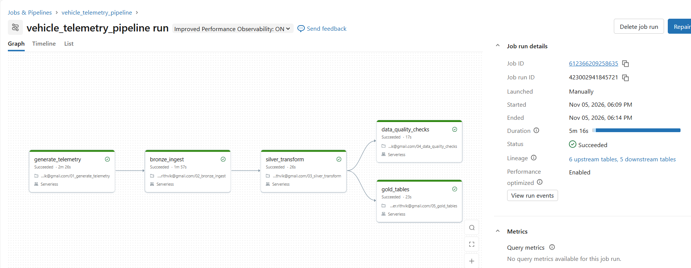

# Vehicle Telemetry Lakehouse

A bronze/silver/gold lakehouse on Databricks for simulated vehicle telemetry, with data quality checks and a Databricks Job that runs the whole pipeline end to end. Personal learning project.

**Data is fully synthetic.** No employer or client data, code, schemas or table names are used anywhere in this repo.

## The problem

Connected vehicles stream readings (speed, RPM, engine temperature, battery voltage, GPS, fault codes). Raw, that data is messy: duplicates, missing values, impossible sensor readings, late-arriving events. This project turns it into trustworthy tables, and measures how trustworthy they are instead of assuming.

## Architecture



```
generator -> landing files (JSON, hourly)
          -> Bronze  (Auto Loader, append-only Delta, nothing dropped)
          -> Silver  (typed, exact duplicates removed, bad rows quarantined with a reason)
                 |-> Data quality checks -> dq_results table
                 |-> Gold: trip summaries + vehicle daily health
```

| Layer | Table(s) | What it does |
|---|---|---|
| Generator | landing volume, labels file | Seeded script simulating 20 vehicles over 7 days, one reading every 10 seconds. Deliberately injects duplicates, nulls, out-of-range values, GPS jumps and late timestamps. Injected faults are recorded in a labels file for later anomaly-detection evaluation. |
| Bronze | `bronze_telemetry` | Auto Loader into an append-only Delta table. Raw fields kept as-is, plus `_source_file`, `_ingest_ts` and `_rescued_data`. |
| Silver | `silver_telemetry`, `quarantine_telemetry` | Casts types, removes exact duplicates (compared on business columns, not ingestion metadata), moves rows with missing keys or impossible values to quarantine with a reason. Late rows stay in Silver, flagged, because late is not the same as wrong. |
| Data quality | `dq_results` | Five named rules with thresholds. Results are appended every run, so the table becomes a quality history. |
| Gold | `gold_trip_summary`, `gold_vehicle_daily_health` | Trips (a new trip starts after a 10-minute gap) and one row per vehicle per day, including that day's quarantine count. |

## Results from the last full run

All numbers below are measured, not estimated.

- 168 landing files (7 days x 24 hours)
- Bronze: 1,233,864 rows, equal to the landing-file line count
- Silver: 1,179,958 rows. Quarantine: 11,781 rows (0.95% of Bronze)
- Gold: 26 trip rows, 158 vehicle-day rows
- Data quality: 4 of 5 rules pass. The failing rule is explained in [NOTES.md](NOTES.md).
- Databricks Job: 5 tasks, 5m 16s end to end on serverless compute
- Re-running the full Job leaves every layer's row count unchanged

## Known findings

The data quality checks surfaced a real issue, traced to how the generator simulates late data. Shifting a timestamp back by whole minutes lands it exactly on another reading's 10-second slot, which causes two things downstream:

1. About 33,000 `(vehicle_id, event_ts)` keys appear more than once in Silver, with different sensor values. They are not exact duplicates, so exact-match dedup correctly keeps them.
2. Some timestamps shift across midnight, so Gold has dates from 2025-12-31 to 2026-01-07 (8 days instead of 7), giving 158 vehicle-days instead of the expected 140.

Takeaway: `(vehicle_id, event_ts)` is not a safe natural key for telemetry. A production system would need a unique event ID or an explicit conflict rule such as last-write-wins. Full write-up with the evidence queries is in [NOTES.md](NOTES.md).

## How to run

Built on a personal Databricks Free Edition workspace (serverless compute). Catalog and schema default to `main.vehicle_telemetry` and can be changed with the notebook widgets.

1. Import the notebooks from `notebooks/` into your workspace.
2. Run them in order: `01_generate_telemetry`, `02_bronze_ingest`, `03_silver_transform`, `04_data_quality_checks`, `05_gold_tables`.
3. Or create a Databricks Job with these five tasks. `bronze_ingest` depends on `generate_telemetry`, `silver_transform` on `bronze_ingest`, and both `data_quality_checks` and `gold_tables` on `silver_transform`.

## Design choices and trade-offs

- **Silver and Gold use full overwrite**, not MERGE or streaming. That keeps the first version simple to verify. A production version would process only new data incrementally.
- **Quarantine instead of delete.** Bad rows keep a reason, so data quality can be measured and reported.
- **Thresholds are explicit constants**, not tuned until everything passes.
- **Trip detection is a simple gap rule.** A real system would use ignition or trip-start signals.

## Repo layout

```
notebooks/   five Databricks notebooks (generator, bronze, silver, data quality, gold)
docs/        pipeline run screenshot
NOTES.md     data quality findings and root-cause analysis
```

## Status

Core pipeline complete. Possible next step: MLflow anomaly detection on the Gold features, evaluated against the injected-fault labels.
